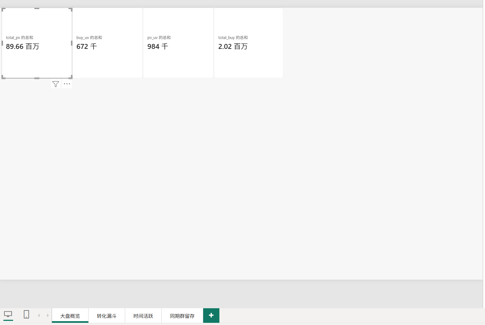
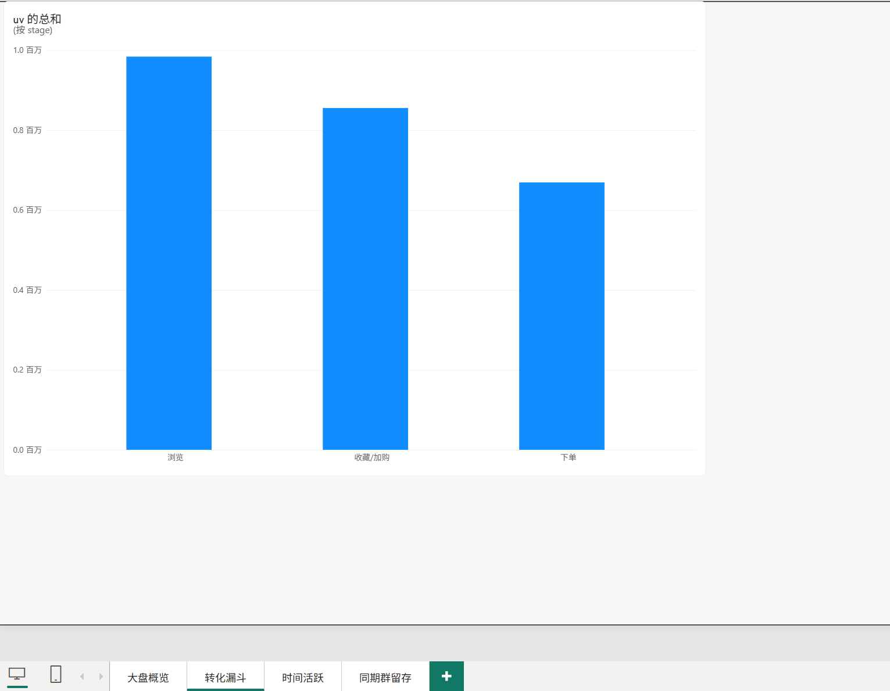
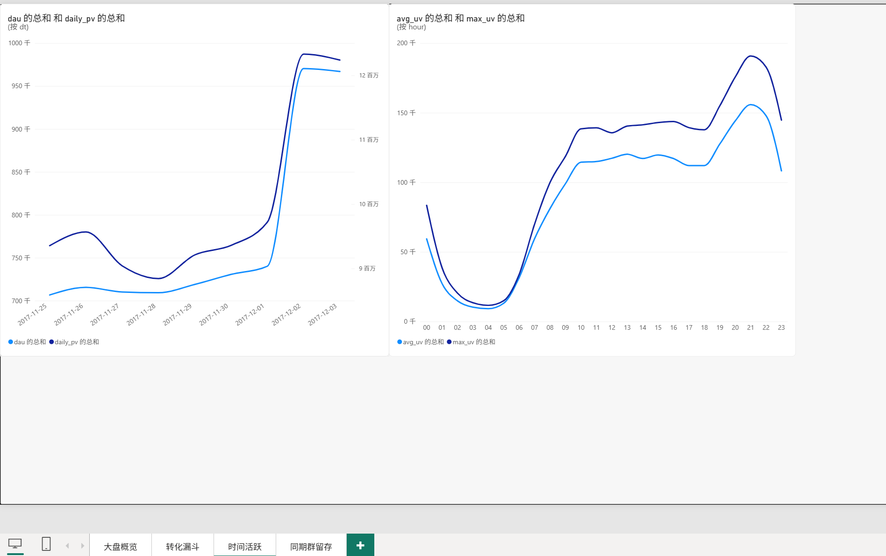
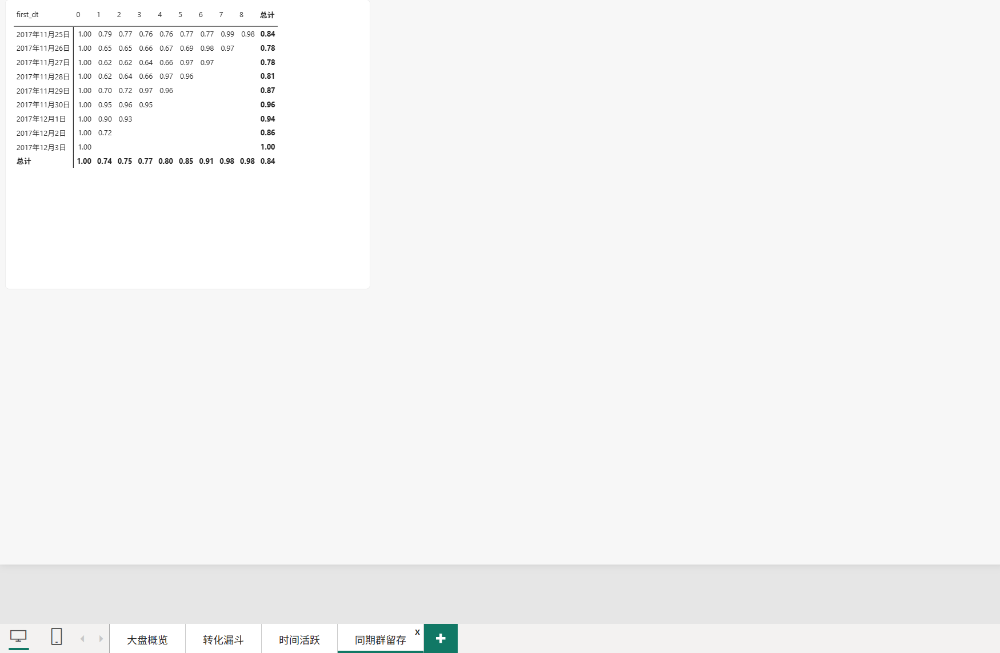

# 电商APP用户行为转化与留存分析

## 项目背景
基于阿里天池淘宝匿名用户埋点行为数据，分析用户浏览、收藏、加购、下单全链路行为，
识别转化漏斗瓶颈、用户活跃规律与新用户留存情况，为产品推荐、运营活动提供数据支撑。

## 数据说明
- **数据来源**：阿里云天池 UserBehavior 数据集
- **时间区间**：2017-11-25 ~ 2017-12-03（共 9 天）
- **字段**：user_id, item_id, category_id, behavior, timestamp
- **行为定义**：pv=浏览，fav=收藏，cart=加购，buy=下单
- **数据规模**：累计浏览记录约 8966 万条，活跃用户约 98.4 万
- **局限**：无商品价格、无流量渠道、无用户基础画像，不支持营收、ROI、客单价分析；9天窗口较短，Cohort 留存仅能观测 D0~D8。

## 分析流程
1. **数据清洗**：Unix 时间戳转标准日期与小时字段，去重，按有效时间窗口过滤样本，生成分析宽表 `ub_clean`，并在 user_id、dt 字段建索引。
2. **大盘指标统计**：PV、UV、DAU、收藏量、加购量、下单量、购买用户数。
3. **转化漏斗分析**：以“浏览 → 下单”两级为主漏斗（严格嵌套，后一阶段为前一阶段的子集），收藏/加购不计入主漏斗，作为深度互动分支单独统计其渗透率与下单率。
4. **时间维度分析**：日活跃趋势、24 小时活跃分布，定位活跃高峰时段。
5. **类目分析**：统计各类目浏览量与购买用户规模，定位高流量头部类目。
6. **同期群 Cohort 留存分析**：按用户首次访问日分组，追踪后续日期回访率。

## 核心指标结论
- **大盘**：9 天累计 PV 8966 万，UV 98.4 万，下单用户 66.9 万，总下单次数 201 万。
- **转化漏斗**：主漏斗为两级——浏览用户 984,105 人，下单 669,310 人，浏览→购买转化率 68.0%。看板中的三级展示（浏览 984,105 → 收藏/加购 855,498 → 下单 669,310）需注意口径：「下单」这一级并非严格包含于「收藏/加购」，其中 69,032 人（占浏览用户 7.0%）未产生收藏或加购行为即直接下单，真正经过收藏/加购路径完成下单的为 600,278 人（在该人群内转化率 70.2%）。因此收藏/加购不作为购买的必要前置环节，仅作为深度互动信号单独呈现：该人群下单率 70.2%，未产生深度互动的用户下单率 53.7%，两者相差 16.5 个百分点。可见收藏/加购显著提升转化意向，但非必经路径。因数据集为活跃用户抽样，绝对转化率高于平台真实水平，结论仅用于用户行为的横向比较。
- **活跃规律**：用户活跃高峰集中在晚间 21 点前后。
- **留存**：以首次访问日划分同期群，新用户次日留存率约 79%（注：该数值为 9 天活跃用户样本内口径，受大促期间高频用户影响，偏高）。
- **类目**：头部类目单类目贡献约 448 万次浏览、2.4 万购买用户，流量集中度较高。

## 关键图表

**Power BI 交互看板（四页）**

| 页面 | 预览 |
| --- | --- |
| 大盘概览 |  |
| 转化漏斗 |  |
| 时间活跃 |  |
| 同期群留存 |  |

**Python 静态图表**

| 图表 | 产出文件 |
| --- | --- |
| 24 小时分时段活跃 UV（日均 + 单日峰值） | `dashboard/img/hour_active.png` |
| 每日 DAU 趋势、每日 PV 趋势 | `dashboard/img/daily_dau.png`、`dashboard/img/daily_pv.png` |
| 用户级转化漏斗（浏览→下单） | `dashboard/img/funnel.png` |
| 类目 Top20 明细、同期群留存矩阵 | `dashboard/img/cat_top20.csv`、`dashboard/img/retention.csv` |

## 业务建议
1. **针对加购未下单用户**：在购物车页推送优惠券、库存提醒、限时活动。加购人群下单率 70.2%，未加购人群 53.7%，相差 16.5 个百分点，购物车与收藏夹是最值得投入的挽回阵地。
2. **流量高峰时段运营**：晚间 21 点前后增加优质商品推荐、直播、弹窗活动，承接高峰流量。
3. **头部类目专项优化**：对高流量类目优化商品主图、详情页与评价体系，提升浏览向购买的转化效率。
4. **新用户召回**：对仅浏览未加购的用户，通过首页个性化推荐与兴趣商品 push 引导二次回访。

## 工具栈
- **MySQL**：亿级数据存储、清洗、聚合查询（CTE、窗口函数、漏斗、Cohort）
- **Python (Pandas + Matplotlib)**：全量指标复算与交叉校验、静态图表绘制
- **Power BI**：交互式看板搭建，含大盘概览、转化漏斗、时间活跃、同期群留存四个模块

## 项目结构
- `sql/`：建表、清洗、统计分析 SQL
- `python/`：Pandas EDA 与 Matplotlib 绘图脚本
- `dashboard/img/`：Matplotlib 输出的静态图表
- `dashboard/powerbi/`：Power BI 看板页面截图
- `data/`：原始数据自行从天池下载，不纳入仓库
